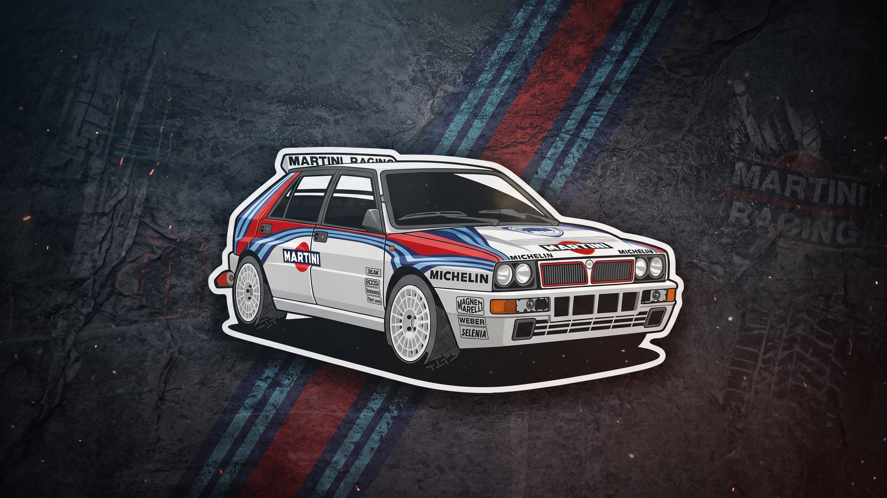

# 🏁 Martini Lancia Delta — Omarchy Theme



A motorsport-inspired theme for [Omarchy Linux](https://omarchy.org/) celebrating the legendary **Lancia Delta HF Integrale** in its iconic **Martini Racing** livery.

Built for high performance, sharp angles, and distraction-free terminal work with a deep navy backdrop, electric sky blue accents, and signature racing red highlights.

---

## ⚡ Quick Install

Install directly via Omarchy CLI:

```bash
omarchy theme install https://github.com/signorinacali/omarchy-martini-lancia-delta-theme.git
```

Omarchy will automatically clone the theme, generate matching configurations across your system (Hyprland, status bar, terminals, Neovim, btop, and lock screen), and apply it immediately.

---

## 🎨 Color Palette

| Swatch | Color Name | Hex Code | Role |
|:---:|---|---|---|
| 🟦 | **Martini Deep Navy** | `#04255A` | Border Base / Contrast |
| 🩵 | **Martini Electric Cyan** | `#21A5F6` | Primary Accent / Vinyl Stripe |
| ⬜ | **Rally White** | `#FFFFFF` | Pinstripe Accent / Bodywork highlight |
| 🟥 | **Martini Racing Red** | `#E4002B` | Core Livery Stripe / Highlights |
| 🌌 | **Dark Slate Navy** | `#121a28` | Window Background |
| ⬛ | **Midnight Dark Navy** | `#0e141e` | Status bars / Sidebar contrast |

---

## 🏁 Rotating Martini Livery Border & Rounded Windows (Rice)

For the full motorsport rice experience — including **rounded windows**, **3px border width**, and the **continuously rotating Martini Racing ribbon** — add this block to the bottom of `~/.config/hypr/hyprland.lua` (or `~/.config/hypr/looknfeel.lua`):

```lua
-- ── Lancia Delta HF Integrale: Martini Racing Livery Border Gradient ──
local martini_active_border = {
  colors = {
    "rgba(04255AF2)", -- Deep Navy Blue
    "rgba(21A5F6F2)", -- Martini Electric Cyan
    "rgba(FFFFFFF2)", -- Rally White Accent
    "rgba(E4002BF2)", -- Martini Racing Red Center
    "rgba(FFFFFFF2)", -- Rally White Accent
    "rgba(21A5F6F2)", -- Martini Electric Cyan
    "rgba(04255AF2)", -- Deep Navy Blue
  },
  angle = 45,
}

local martini_inactive_border = {
  colors = {
    "rgba(04255A66)",
    "rgba(21A5F644)",
    "rgba(E4002B33)",
    "rgba(04255A66)",
  },
  angle = 45,
}

hl.config({
  general = {
    col = {
      active_border = martini_active_border,
      inactive_border = martini_inactive_border,
    },
    border_size = 3,
    gaps_in = 6,
    gaps_out = 14,
  },
  decoration = {
    rounding = 14,      -- Smooth curved window corners
    dim_inactive = true,
    dim_strength = 0.12,
  },
  group = {
    col = {
      border_active = martini_active_border,
      border_inactive = martini_inactive_border,
      border_locked_active = martini_active_border,
      border_locked_inactive = martini_inactive_border,
    },
  },
})

-- Smooth circular animation: slowly rotates the Martini Racing vinyl stripes around the border
hl.animation({
  leaf = "borderangle",
  enabled = true,
  speed = 100,      -- ~10s per full rotation (smooth & ambient)
  bezier = "linear", -- Constant speed, zero stutter
  style = "loop",   -- Continuous loop
})
```

> **Performance Note**: The animation is executed purely via GPU fragment shaders in Hyprland with zero extra RAM impact (~0 MB). Hyprland automatically hot-reloads on save!

---

## 🖼️ Included Wallpapers

The theme includes a diverse set of 5 wallpapers covering different desktop moods:

1. **`0-hero-rally.jpg`** — Authentic rally action shot of the Delta Integrale in full flight.
2. **`1-minimal-stripes.png`** — 4K clean diagonal Martini Racing stripes on deep navy with minimal HF Integrale branding.
3. **`2-night-stage.jpg`** — Moody atmospheric night rally stage with glowing quad fog lamps.
4. **`3-retro-ascii.png`** — Stylized retro ASCII / terminal art wallpaper.
5. **`4-blueprint.jpg`** — Clean engineering blueprint / schematic on deep navy.

### Cycling Wallpapers

Cycle through the wallpapers at any time:

```bash
omarchy theme bg next
```

---

## 🛠️ Manual Installation (Local)

If you have cloned this repository manually:

```bash
# Symlink or copy to Omarchy themes directory
ln -s "$(pwd)" ~/.config/omarchy/themes/martini-lancia-delta

# Apply theme
omarchy theme set "Martini Lancia Delta"
```

---

## 📄 License

Distributed under the [MIT License](LICENSE).
Wallpapers and rally imagery remain copyright of their respective creators and are included for personal desktop use.
